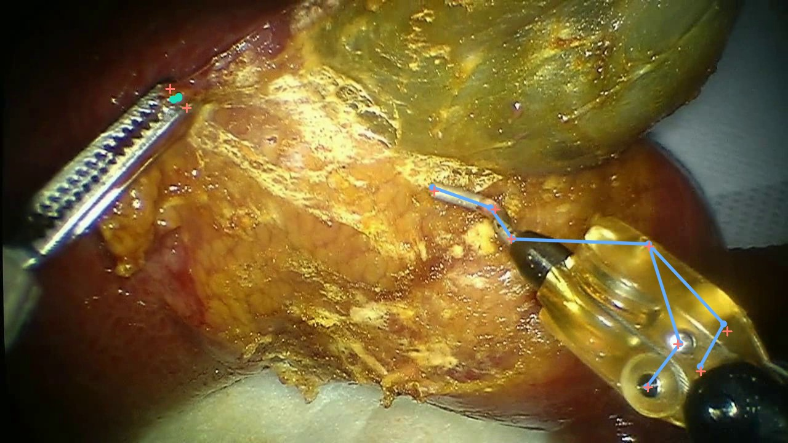

# Instrument Pose · CRCD

An interactive GitHub Pages research showcase of actual ViTPose++ instrument-keypoint predictions.

**Project page:** https://michaelwanggo.github.io/crcd-instrument-keypoints/

[](https://michaelwanggo.github.io/crcd-instrument-keypoints/)

## What you can explore

- Three continuous, 120-frame held-out clips: relatively stable, typical, and challenging windows.
- Synchronized raw video + original-coordinate canvas overlays for both FBF and PCH.
- Play/pause, step, scrub, playback speed, tool selection, GT/prediction/trajectory/box/label controls.
- Measured per-frame error curves; complete effective-test-set metrics and failure cases.
- Downloadable H.264 overlay videos, numerical summaries, CSV statistics, and the analysis report.
- Responsive Chinese-first layout, accessible controls, and self-hosted subset fonts.

## Scope of the temporal visualization

**These are framewise 2D keypoint estimates, not a trained temporal tracking model.**
Ground-truth boxes and annotation-assisted instrument identities are used. Two instrument records are combined
only after confirming that their frame numbers match and the source image bytes have identical SHA256 hashes.
Trails connect adjacent predicted tip positions; there is no temporal filtering, identity association model,
tracking benchmark, or 3D reconstruction. Replays are encoded at 12 FPS for presentation; source capture
timestamps have not been mapped or verified.

Clip windows are selected deterministically near the 20th, 50th, and 90th percentiles of candidate-window
mean visible-point errors, without changing or reselecting the model. Clip values are not full-test metrics.

## Experimental record

- Pretrained ViTPose++-Base + two surgical MoE experts, FBF-5 / PCH-8 output heads.
- Best checkpoint: epoch 27, selected using validation macro visible mean pixel error.
- Complete effective test set: 6,149 instances (FBF 2,892 / PCH 3,257).
- Visible-point test mean error: FBF 18.79px; PCH 37.06px; two-tool macro 27.92px.
- [Training run](https://forge.coreweave.com/wandb/xu-wang-23/crcd-vitpose-plus/runs/srjp103z)
- [Independent analysis](https://forge.coreweave.com/wandb/xu-wang-23/crcd-vitpose-plus/runs/2cx0caf6)

## Files and hosting

`docs/` is buildless HTML/CSS/JavaScript and media. GitHub Pages serves `main:/docs`.
The site makes no authenticated API requests and embeds no API keys. There are no model checkpoints,
environment directories, or full raw datasets in this repository.

Local preview:

```bash
python scripts/serve.py
```

Open http://localhost:8765/ through a local HTTP server so JSON fetches work.

On the source training machine, regenerate assets from the existing measured predictions:

```bash
/root/miniconda3/envs/crcd-vitpose/bin/python scripts/build_assets.py
/root/miniconda3/envs/crcd-vitpose/bin/python scripts/fetch_font.py
```

## Attribution and licenses

CRCD data and images: Ki-Hwan Oh, Leonardo Borgioli, Alberto Mangano, Valentina Valle, Marco Di Pangrazio,
Francesco Toti, Gioia Pozza, Luciano Ambrosini, Alvaro Ducas, Miloš Žefran, Liaohai Chen,
Pier Cristoforo Giulianotti. [Official dataset](https://github.com/SITL-Eng/CRCD),
[paper](https://arxiv.org/abs/2412.12238), **CC BY 4.0** (see `LICENSE-CRCD`).
Media modifications include resizing, replay encoding, and keypoint/trajectory overlays.

ViTPose / ViTPose++: Yufei Xu, Jing Zhang, Qiming Zhang, Dacheng Tao.
[Official implementation](https://github.com/ViTAE-Transformer/ViTPose).

Site source code: MIT (`LICENSE`). Noto Sans SC font: SIL Open Font License 1.1
(`docs/assets/fonts/OFL.txt`). The code license does not replace the dataset, media, or original-model licenses.
